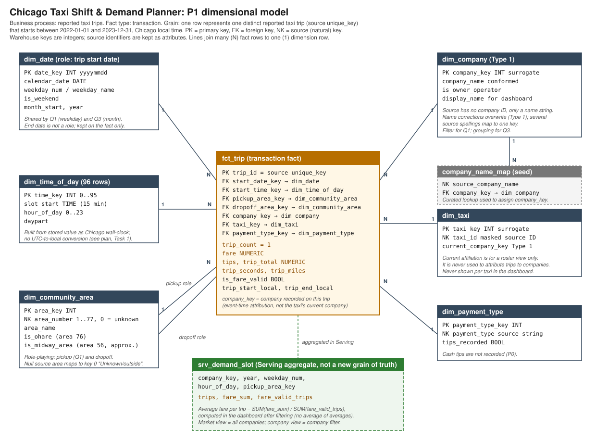

# P1: Grain, Model, History & Pipeline Plan

**Project:** Chicago Taxi Shift & Demand Planner
**Status:** revised P1 plan (2026-10-25). I missed the M07 class, so Task 4 records a self-diagnosis in place of partner feedback.

**Linked artifacts**
- Model diagram: [`docs/model.svg`](model.svg)
- Profiling and grain-check code: [`sql/01_source_profile.sql`](../sql/01_source_profile.sql). Query numbers below (Q1–Q4D) refer to this file.
- Reused P0 work: [`docs/p0-feasibility.md`](p0-feasibility.md), [`sql/00_feasibility.sql`](../sql/00_feasibility.sql), [`evidence/p0-feasibility-results.md`](../evidence/p0-feasibility-results.md)

All P1 queries ran on 2026-10-25 from my execution project `savvy-primacy-249323` (US). This repository holds aggregate results only, with no source rows.

---

## 1. Establish the question and check the source

### Audience, need and question (carried forward from P0)

**Audience and need.** The operations manager of a mid-size Chicago taxi company ("Maria"). Each week she decides how many drivers to schedule per shift and where to position cabs at shift start. Today those decisions rest on habit.

**Primary question (Q1).** For a selected company, compared with the whole market: which hour-of-day × weekday × pickup community area slots had the most trips and the highest average fare per trip in 2022–2023?

**Supporting question (Q3).** How did the selected company's monthly share of reported market trips change from 2022 through 2023? The same fact table and grain answer it.

**Material changes from P0**

| Change | Reason |
|---|---|
| Four questions narrowed to one primary (Q1) and one supporting (Q3). Q2 (airport) and Q4 (tips) are out of P1 scope. | P1 asks for one primary question. The model keeps an airport flag and a payment-type dimension, so Q2 and Q4 can return later without a new grain. |
| Q1's money measure is now **average fare** (`fare`), not average `trip_total`. | `trip_total` includes tips, and cash tips are not recorded (P0 query 9). Areas and hours with more cash trips would look less valuable for a reason that has nothing to do with demand. |
| The company comparison is no longer at risk. P0 named dropping it as the fallback. | P0 found `company` null on 15.8% of all rows. In the 2022–2023 window it is null on **0** rows (Q2 below). |
| Company now needs a curated name mapping and an explicit history rule. | Q4A–Q4D found renamed companies and taxis that change company (Task 2). |

**P0 review status.** Approved for P1 (instructor feedback, 2026-10-16). The feedback named three points, and this plan resolves each one:

| P0 feedback | Resolution in P1 |
|---|---|
| Decide how to treat repeated keys before building the trip fact. | Task 1 grain test. The repeated keys are only in 2013 and 2019, and there are 0 in the 2022–2023 window. The fact is scoped to the window, and the build asserts zero repeats (check R1). A selection rule is required before any extension to 2013 or 2019. |
| Keep the product labeled as a historical planning baseline. | The dashboard title and README describe it as a 2022–2023 historical planning baseline, not live operations (Task 3, largest limitation). |
| Describe company share as a share of reported trips. | Q3 is defined as share of **reported** taxi trips. The Serving view and dashboard label use "share of reported taxi trips" (Task 3, limitation). |

My P0 question ("Is a static source fine, with the course change case used later?") was answered by the approval. The history test in Task 2 uses a change that occurs naturally in the source, and it can also take the course-supplied case in P3.

### Source objects

| Item | Value |
|---|---|
| Object used | `bigquery-public-data.chicago_taxi_trips.taxi_trips` (project `bigquery-public-data`, dataset `chicago_taxi_trips`, table `taxi_trips`). It is the only object in the dataset. Provider: City of Chicago. |
| Row meaning | One reported taxi trip: start and end time, duration, distance, pickup and dropoff community area, fare components, payment type, company name, masked taxi ID. |
| Size and coverage | 213,111,447 rows, 77.29 GiB, 2013-01-01 to 2023-12-31, unpartitioned (P0 queries 3–4). The source is static: there are no trips after 2023. |
| Window used | Trips starting 2022-01-01 to 2023-12-31: **12,877,486 rows** (6,382,071 in 2022; 6,495,415 in 2023). |
| Candidate identifiers | `unique_key` (trip), `taxi_id` (masked vehicle; 3,689 distinct in window), `company` (a name string, with no company ID; 42 distinct names in window). |
| Issue that affects Q1 | `pickup_community_area` is null on **755,383** window trips (5.87%). These are trips outside Chicago or suppressed for privacy. They stay in market totals under an "Unknown/outside" area, so trip counts still reconcile. |
| Restriction | City of Chicago Terms of Use. Attribution is required, and no row-level redistribution. Times are rounded to 15 minutes. |

### Grain test

**Proposed grain:** one fact row per `unique_key`, meaning one row per reported trip. Check code: Q1 in [`sql/01_source_profile.sql`](../sql/01_source_profile.sql), adapted from the course template, with a `ROLLUP` by year and a separate count for the window.

| Scope | Source rows | Rows with null `unique_key` | Repeated-ID groups | Excess rows |
|---|---|---|---|---|
| Expected (if `unique_key` is a trip ID) | — | 0 | 0 | 0 |
| **Observed, full table** | 213,111,447 | 0 | **1,455,988** | 1,455,988 |
| of which first seen in 2013 | 27,223,578 | 0 | 6,278 | 6,278 |
| of which first seen in 2019 | 17,926,150 | 0 | 1,449,710 | 1,449,710 |
| all other years | 167,961,719 | 0 | 0 | 0 |
| **Observed, 2022–2023 window** | **12,877,486** | **0** | **0** | **0** |

Further detail from the same query:
- Every repeated key has exactly 2 rows (`max_rows_per_id` = 2).
- No repeated pair spans two years.
- No key in the window also appears outside it.

**Conclusion.** The result **supports** the grain "one row per `unique_key`" inside the 2022–2023 window, so the fact needs no selection rule there. The full-table result **qualifies** the grain. `unique_key` is not a reliable trip ID in 2013 and 2019. Any later extension of the window to those years needs a profiled selection rule before loading. I did not profile whether those pairs are exact copies, because doing so scans about 60 GB and does not affect the chosen window. The planned build still asserts zero repeats (Task 3, check R1), because a zero result supports uniqueness but does not prove that each row is a useful trip.

### Targeted evidence: two ambiguities that could change the model's meaning

**A. Do the timestamps mean UTC or Chicago local time?** This decides what "hour of day" means in Q1. The column type is `TIMESTAMP`, which BigQuery treats as UTC. If the values were true UTC, a conversion to `America/Chicago` would be required, and every demand slot would move 5–6 hours. Q2 and Q3 test this.

| Check (stored values) | Result | Meaning |
|---|---|---|
| Trips at 02:00–02:59 on spring-forward Sundays 2022-03-13 and 2023-03-12 | **0** and **0** | That hour does not exist on Chicago clocks on those days. |
| Same hour on the neighbouring Sundays (Mar 6/20, 2022; Mar 5/19, 2023) | 361, 349, 257, 248 | Normal overnight volume. |
| 01:00–01:59 on fall-back Sunday 2023-11-05, compared with Oct 29 and Nov 12 | 511 vs. 470 and 243 | That hour occurs twice on Chicago clocks, so volume is higher than usual. |
| Busiest and quietest stored hour (window) | 17:00 (921,860 trips), 03:00 (70,986) | This is a local evening peak. In true UTC the peak would fall at 22–00. |

**Decision.** The stored value is **Chicago wall-clock time with a UTC label**. The curated layer stores it as `DATETIME` (`trip_start_local`) with **no time-zone conversion**. `dim_time_of_day` and `dim_date` are derived from that value. Applying `AT TIME ZONE 'America/Chicago'` would be a silent error, so check R2a in Task 3 guards against it.

**B. Do the 2019 duplicates affect the chosen window?** No. All repeated keys are in 2013 and 2019 (table above). The P0 "first P1 decision" (choose a dedupe rule) therefore becomes "scope the fact to 2022–2023, assert uniqueness, and defer the rule".

---

## 2. Define the model and predict a history consequence

### Process, fact type and grain

- **Business process:** taxi trips reported to the City by Chicago taxi companies.
- **Fact table type:** transaction fact (`fct_trip`).
- **Grain statement:** *One row represents one distinct reported taxi trip, identified by the source `unique_key`, that starts between 2022-01-01 00:00 and 2023-12-31 23:45 Chicago local time.*

**Consequential choice: keep the atomic trip grain in Curated and aggregate only in Serving.** A pre-aggregated fact at company × date × 15-minute slot × pickup area would be cheaper to query. However, it would fix the measures as stored averages and lose the trip denominator, and averages of averages are wrong after filtering. It would also block later drill-down to dropoff area, payment type or the airport flag (Q2, Q4). The trade-off is cost. The atomic fact is about 12.9M rows, so Serving gets a small aggregate (`srv_demand_slot`). That aggregate stores additive pieces only (`trips`, `fare_sum`, `fare_valid_trips`), and the dashboard divides after filtering.

### Diagram

Source: [`docs/model.svg`](model.svg). It shows one fact (`fct_trip`), six dimensions, the `company_name_map` seed and the Serving aggregate. Q1 and Q3 share the trip grain, so a second fact is not needed.

| Table | Key strategy | Main attributes / measures |
|---|---|---|
| `fct_trip` | `trip_id` = source `unique_key` (degenerate key); integer foreign keys to each dimension | `trip_count` (=1), `fare`, `tips`, `trip_total`, `trip_seconds`, `trip_miles`, `is_fare_valid`, `trip_start_local` |
| `dim_date` | `date_key` = yyyymmdd (smart key), role **trip start date** | weekday, is_weekend, month_start, year |
| `dim_time_of_day` | `time_key` 0–95 (15-minute slot) | slot_start, hour_of_day, daypart |
| `dim_community_area` | `area_key` = source area number 1–77; 0 = unknown/outside | area_name, is_ohare (76), is_midway_area (56). Role-playing as pickup and dropoff. |
| `dim_company` | surrogate `company_key`; the source has no company ID | conformed company_name, display_name, is_owner_operator |
| `company_name_map` | natural key = source company string | `company_key` (many source spellings → one company) |
| `dim_taxi` | surrogate `taxi_key`; natural key = masked `taxi_id` | current_company_key (Type 1, roster use only) |
| `dim_payment_type` | small integer key; natural key = source string | tips_recorded flag |

### Question-to-model trace

| Question | Fact / Serving object | Measures | Dimensions (role) | Filters |
|---|---|---|---|---|
| **Q1** | `fct_trip` → `srv_demand_slot` | trips = SUM(`trip_count`); average fare = SUM(`fare` where `is_fare_valid`) ÷ COUNT(valid trips) | `dim_time_of_day.hour_of_day`; `dim_date.weekday_name` (trip start date); `dim_community_area.area_name` (pickup) | Company view: `dim_company.company_name` = selected company. Comparison: other companies (market minus selected). Average fare hidden below 30 fare-valid trips per cell. Year 2022–2023. Area key 0 shown as "Unknown/outside". |
| Q3 | `fct_trip` | company trips ÷ market trips per month | `dim_date.month_start` (trip start date); `dim_company` | Same company selection; denominator = all companies. |

### Date roles and shared meaning

- **Trip start date is the only date role.** Maria positions cabs for pickups, and Q2 shows that 90,806 window trips (0.7%) end on a later date and 3,156 end in a later month. Using the end date for some charts and the start date for others would make Q1 and Q3 disagree. End time stays on the fact as an attribute (`trip_end_local`). The 208 trips that end before they start and the 294 with a null end do not affect start-date reporting.
- **One conformed company dimension** feeds both Q1 (company filter) and Q3 (share numerator). Both questions therefore use the same company names.
- **"Average fare" has one definition:** `fare` > 0 and ≤ $1,000. It is computed from additive Serving columns. Q2 found 27,192 window trips with a null or non-positive fare. These count as trips but are excluded from the fare average.
- **Small cells:** the dashboard shows an average fare only where a cell has at least 30 fare-valid trips. Smaller cells still show their trip count but are marked "too few trips". This matters most in the company view, where a slot × weekday × area cell can hold only a handful of trips.
- **Market comparison:** "other companies" = market minus the selected company. It is computed from the same additive Serving columns, so a large company is not compared against a total that includes itself.

### History decision: company affiliation changes over time

**Source keys vs. warehouse keys.**
- `taxi_id` is a stable masked source ID.
- `company` is only a name string, and that string changes for the same company.
- The warehouse therefore assigns a surrogate `company_key` through `company_name_map`, and `taxi_key` for taxis. Source values stay as attributes.

**Evidence that the attribute changes (Q4B–Q4D, 2022–2023)**
- 853 of 3,689 taxis (23.1%) record more than one company. Those taxis made 3,812,935 trips (29.6% of window trips).
- Most switching taxis change once or twice (quartiles of changes: 1, 1, 1, 2), but one taxi changes 14 times.
- The largest flows are real moves between companies, spread over many dates. Flash Cab → 5 Star Taxi: 571 switches by 413 taxis between 2022-05-31 and 2023-12-29. 5 Star Taxi → Flash Cab: 398 switches.
- Some changes are **renames**, not moves. "Blue Ribbon Taxi Association Inc." is last seen 2022-06-18, and "Blue Ribbon Taxi Association" is first seen 2022-04-24. Thirty-six of the 72 switching taxis changed on the same cut-over date, 2022-04-24. "KOAM Taxi Association" (to 2022-06-20) and "Koam Taxi Association" (from 2022-04-24) follow the same pattern.

**Two separate treatments**

| Change | Treatment | Why |
|---|---|---|
| A taxi moves to another company (real change) | **Event-time attribution:** `fct_trip.company_key` comes from the company recorded on that trip. `dim_taxi.current_company_key` is Type 1 and is used for a current roster only, never for trip attribution. | Maria's question is about trips her company actually served at that time. Each trip carries its own company, so the history is preserved on the fact without a Type 2 dimension. This gives the same reporting result as a Type 2 taxi dimension with less machinery. |
| Same company, different spelling (rename or punctuation) | **Type 1 conformance in `dim_company`:** several source names map to one `company_key`, and a corrected display name overwrites the old one. Merge rule: merge only when names differ by case, punctuation or a legal suffix (Inc, LLC, Corp). Merged: Blue Ribbon, Choice Taxi Association, KOAM/Koam, Taxicab Insurance Agency. Not merged: "Top Cab" vs. "Top Cab Affiliation" (taxis moved from the latter to Chicago City Taxi Association in May 2023) and "Taxi Affiliation Services Llc - Yell". Result: 42 source names → 38 companies. | A spelling change is not a business change. Without the merge, one company appears as two in Q3, and its history splits at the rename. |

**Predicted effect on the primary question, compared with the plausible alternatives (Q4A)**

| Company | Event-time (planned), 2022 → 2023 trips | Share | Type 1 (taxi's latest company), 2022 → 2023 | Share |
|---|---|---|---|---|
| 5 Star Taxi | 157,880 → 299,448 (**+89.7%**) | 2.47% → 4.61% | 327,439 → 308,121 (**−5.9%**) | 5.13% → 4.74% |
| Flash Cab | 1,406,928 → 1,259,259 (**−10.5%**) | 22.05% → 19.39% | 1,241,821 → 1,260,014 (**+1.5%**) | 19.46% → 19.40% |
| Chicago City Taxi Association | 0 → 48,692 | 0% → 0.75% | 91,655 → 78,597 | 1.44% → 1.21% |

**Interpretation.**
- If Maria runs 5 Star Taxi, the Type 1 alternative reverses her story. Event-time shows her company almost doubled, while Type 1 shows a slight decline.
- In Q1, Type 1 adds a net 169,559 trips to 5 Star's 2022 total (52% of its Type 1 figure). These trips were recorded under other companies, mostly Flash Cab, before those taxis joined 5 Star. Her hour × weekday × area heat map would then show competitors' demand.
- Type 1 also gives Chicago City Taxi Association 2022 demand, although no 2022 trip records that name.

Name conformance changes interpretation too. Unmerged, Blue Ribbon grows 35.4% from 2022 to 2023 (152,032 → 205,906). Merged, it grows 8.9% (189,022 → 205,906). KOAM appears to grow 47.2% unmerged but is flat merged (+0.1%). Both totals reconcile to the 12,877,486 window trips.

**Behavior to implement and test by P3**
1. Build `fct_trip.company_key` from the trip's own company through `company_name_map`, and build `dim_taxi.current_company_key` as Type 1.
2. Apply a bounded change case: a new load reports that one taxi has moved from 5 Star Taxi to Flash Cab. A synthetic delta, or the course-supplied case, works for this.
3. Test that `dim_taxi` shows the new current company, and that `fct_trip` and `srv_demand_slot` totals for 5 Star Taxi in 2022 stay at **157,880** before and after the change.
4. Run the Type 1 attribution query side by side to show the reporting difference.

---

## 3. Plan the build and its checks

### Layers (all in project `savvy-primacy-249323`, location US)

| Layer | Object | Responsibility |
|---|---|---|
| Raw | `taxi_raw.taxi_trips_2022_2023` | One-time copy of all 23 source columns for the window, values unchanged. Partitioned by `DATE(trip_start_timestamp)` and clustered by `company` and `pickup_community_area`. Load metadata `_source_table` and `_loaded_at` are added. The source is read once (about 83 GB). Later steps read only this copy. |
| Curated | `taxi_curated.trip_clean` | Types and flags: `trip_start_local DATETIME` (no time-zone conversion), `fare` as NUMERIC, `is_fare_valid`. Null area becomes 0. Names are trimmed. |
| Curated | `taxi_curated.company_name_map` | Seed written as SQL `VALUES` (42 source names → 38 companies). |
| Curated | `dim_date`, `dim_time_of_day`, `dim_community_area`, `dim_company`, `dim_taxi`, `dim_payment_type` | Conformed dimensions (Task 2). Date and time are generated. Area names come from a 77-row seed. |
| Curated | `taxi_curated.fct_trip` | Trip-grain fact with integer keys. Event-time `company_key`. |
| Serving | `taxi_serving.srv_demand_slot` | Aggregate by company × year × weekday × hour × pickup area: `trips`, `fare_sum`, `fare_valid_trips`. |
| Serving | `taxi_serving.srv_company_share_month` (view) | Monthly company trips and reported market trips for Q3. The measure is labeled "share of reported taxi trips". |
| Audience | Looker Studio report, titled as a "2022–2023 historical planning baseline" | Reads Serving only. Heat map (hour × weekday), area table, company filter, share line. |

### Preliminary run order
1. Create the datasets `taxi_raw`, `taxi_curated` and `taxi_serving` (US).
2. Raw: CTAS of the window (dry-run first, then a byte cap).
3. Raw checks (R1a).
4. Load the seeds: `company_name_map`, community area names, payment types.
5. Generate `dim_date` and `dim_time_of_day`.
6. Build `trip_clean`.
7. Build `dim_company`, `dim_community_area`, `dim_taxi` and `dim_payment_type`.
8. Build `fct_trip`.
9. Run the Curated checks (R1b, R2a, R3).
10. Build `srv_demand_slot` and `srv_company_share_month`.
11. Run the Serving checks (R2b).
12. Connect Looker Studio.

### Field path: `fare` to "average fare per trip"

| Step | Object.field | Transformation |
|---|---|---|
| Source | `taxi_trips.fare` FLOAT64, USD metered fare | none |
| Raw | `taxi_raw.taxi_trips_2022_2023.fare` | copied unchanged |
| Curated | `trip_clean.fare` NUMERIC; `is_fare_valid` | `ROUND(fare, 2)`. The trip is valid when the fare is not null and `0 < fare ≤ 1000`. |
| Curated | `fct_trip.fare`, `fct_trip.is_fare_valid` | joined to dimension keys, one row per trip |
| Serving | `srv_demand_slot.fare_sum`, `fare_valid_trips` | `SUM(IF(is_fare_valid, fare, 0))` and `COUNTIF(is_fare_valid)`, grouped by company_key, year, weekday, hour, pickup_area_key |
| Audience | Looker Studio "Average fare per trip" | `SUM(fare_sum) / SUM(fare_valid_trips)`, computed after the company, area and weekday filters |

### Risks and planned checks

| # | Risk | Planned check | Expected result | Where |
|---|---|---|---|---|
| R1 (grain and relationships) | Repeated or lost trips inflate or deflate counts. Unmatched keys drop trips from joins. | **a.** Raw: row count, null and repeated `unique_key` (the Q1 query applied to Raw). **b.** Fact: `COUNT(*)` vs. `COUNT(DISTINCT trip_id)`; count of null foreign keys; rows with `pickup_area_key = 0`. | a: 12,877,486 rows, 0 null, 0 repeated. b: 12,877,486 = 12,877,486. 0 null keys (all 42 company names map). 755,383 rows in area 0. | a: `taxi_raw` after step 2. b: `taxi_curated` after step 8. Both in `sql/03_checks.sql` (P2). |
| R2 (meaning of the Q1 result) | **a.** A time-zone conversion moves every demand slot. **b.** Invalid fares or averages of averages distort average fare. | **a.** Hour profile of `fct_trip` and trips at 02:xx on 2023-03-12. **b.** Reconcile `srv_demand_slot`: SUM(`trips`) = fact rows; SUM(`fare_valid_trips`) = fact valid rows; the overall average from Serving = the overall average from the fact. | a: peak at hour 17 with 921,860 trips; 70,986 at hour 3; 0 at 02:xx on 2023-03-12 (matches Task 1). b: SUM(`trips`) = 12,877,486. Valid trips = 12,877,486 − 27,192 − (fares above $1,000, at most 934, observed in P2). Averages are equal to the cent. | a: `taxi_curated` after step 8. b: `taxi_serving` after step 10. |
| R2c (meaning of the Q1 result) | Averages from very small cells look like real differences. | For one mid-size company (5 Star Taxi) and for the market, count the hour × weekday × area cells and the share of trips that fall in cells with fewer than 30 fare-valid trips. | Market: almost all trips are in cells at or above the threshold. Company view: many cells are below it. Exact shares are observed in P2 and used to decide whether to coarsen to daypart or a 2-hour block. | `taxi_serving` after step 10. |
| R3 (company history) | Name conformance or the attribution rule silently changes company totals. | Company trips by year from `fct_trip` + `dim_company`; all-company totals per year. | 5 Star Taxi 2022 = 157,880. Blue Ribbon 2022 = 189,022 (merged). Year totals 6,382,071 and 6,495,415. | `taxi_curated` after step 8, and again after the P3 change case. |

### Access choice

| Field | Classification | Choice |
|---|---|---|
| `fare` (traced field) | Public, low risk. It is a city-published metered fare with no personal data. | No restriction. It appears in the output only as aggregates (sum, count, average by slot). Intended user: Maria, the operations manager. Owner and steward of the data product: me (project owner). Source steward: City of Chicago Data Portal. |
| `company` | Mostly business names. However, 10 of the 42 window names are owner-operator entries in the form "medallion number - ID number - name". Some of these contain a person's name. They cover 21,775 trips (0.17%). | **Separate.** Curated keeps the source name, and access stays with the project owner. Serving shows these entries as one group, "Independent owner-operators" (`display_name`), so no person's name can reappear in the dashboard. |
| `taxi_id` | Masked by the City, but it identifies a single vehicle over time. | **Exclude** from Serving. There are no per-taxi results in the dashboard. |

### Largest remaining limitation
The source covers only **reported taxi trips**, and it **ends 2023-12-31**. "Market share" therefore means share of reported taxi trips, not of all rides (rideshare is not included). The planner is a historical baseline for 2022–2023, not a live operations tool. The City also notes that "not all trips are reported".

### First P2 build step
Create the three datasets in `savvy-primacy-249323` (US). Dry-run the Raw CTAS for the 2022–2023 window, then run it with a byte cap. Then run check R1a and confirm 12,877,486 rows, 0 null and 0 repeated `unique_key`.

---

## 4. Diagnose and revise the plan

### Draft before M07
The draft (Tasks 1–3, diagram and check code) was committed on 2026-10-25 as commit `65c5050`.

### How the plan was diagnosed
I was absent from the M07 class, so I did not get a partner diagnosis. Instead I worked through the M07 peer-diagnosis questions on my own draft. For each question, I tried to answer it by pointing to a specific table or check in this plan, and I recorded a change wherever I could not. This is a self-diagnosis, not partner feedback.

| Guide question | Where the plan answers it | Result |
|---|---|---|
| Who will use the result, and what decision does it support? | Task 1, audience and need | Answered |
| What does one source row represent? How did you check? | Task 1, grain test and timestamp evidence | Answered |
| How will the plan answer the main question? What is counted or compared? | Task 2, question-to-model trace | **Gap:** the comparison and the small-cell averages were not defined |
| Could a row be counted twice or left out when data is combined? | Task 3, R1 (repeated keys, unmatched keys, area 0) | Answered |
| If a value changes later, which value should an older report show? | Task 2, history decision | Answered |
| What could make the answer misleading? | Task 3, R2 | **Gap:** small cells were not covered |
| What is still uncertain? | Change memo below | Answered |
| Who decides what the result means? | Task 3, access choice (owner and steward) | Answered |

## P1 change memo

- **Feedback that changed my plan:** From self-diagnosis against the M07 questions (I missed the class): (1) "What will you count or compare?" showed that the plan compared a company with a market total that includes that company. (2) "What could make the answer misleading?" showed that average fare in the company view can rest on very few trips per hour × weekday × area cell.
- **What I changed and why:** I defined the comparison as "other companies" (market minus the selected company) in Task 2. A large company such as Flash Cab (about 20% of trips) would otherwise be compared partly with itself. I also added a 30-trip minimum before an average fare is shown, and a new check, R2c, that measures how many trips fall in small cells. The dashboard should not show noise as a demand pattern.
- **Feedback I did not adopt and why:** (1) A Type 2 `dim_taxi` for company affiliation, which the question "which value should an older report show?" points toward. I kept event-time attribution on the fact instead. Each trip already records its own company, so a Type 2 taxi dimension would give the same report with more machinery. (2) Extending the window back to 2019 for a pre-pandemic baseline. 2019 holds 1,449,710 repeated keys that would need a new selection rule, and 2019 demand does not describe the post-2020 market Maria plans for.
- **Most important remaining uncertainty:** whether "Taxicab Insurance Agency Llc" and "Taxicab Insurance Agency, LLC" are one company. Both names are used throughout the window, and the 107 switches between them are spread over many dates (at most 12 on one day). The plan merges them by the name rule, but the evidence is weaker than for Blue Ribbon or KOAM. In P2 I will check whether the two names share taxis in the same months. If they stay separate, Q3 shares for that company change.

### AI / tool accountability
- **Claude Code (Anthropic):**
  - drafted the profiling SQL in `sql/01_source_profile.sql`;
  - ran the queries from my execution project with dry-runs and byte caps;
  - drafted this plan and the SVG diagram;
  - drafted the Task 4 self-diagnosis against the M07 question list. I reviewed each gap it found and chose which changes to adopt.
- **Verification:**
  - Every number in this plan comes from a query in `sql/01_source_profile.sql`, run on 2026-10-25, or from P0 results.
  - I checked that the window totals reconcile across queries (12,877,486 trips in Q1, Q2 and both treatments of Q4A).
  - The time-zone conclusion rests on a test with a known expected outcome (no trips at 02:xx on spring-forward days), not on documentation alone.
- **Cost note:** P1 profiling billed about 140 GB. That includes one ~35 GB re-run, after a byte cap that was too low stopped a script part-way. The total is within the free query tier.
- **Responsibility:** the modeling choices are mine, including the event-time company attribution, the name-merge rule, average fare instead of trip total, and the 2022–2023 scope. I can explain each one.
